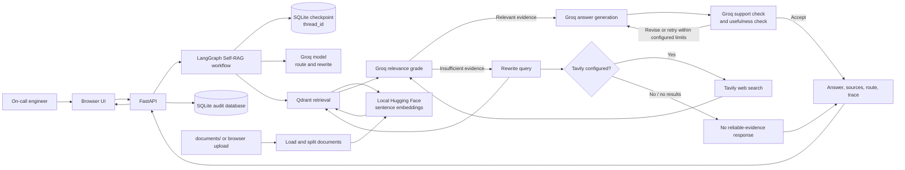

# RunbookPilot

**Evidence-grounded incident response for cloud operations.**

RunbookPilot is a browser-based incident-response assistant for SRE, DevOps, and cloud operations teams. For evidence-based questions, it searches operational documents, checks whether retrieved material is relevant, and verifies generated answers against the available evidence. When configured, it can use Tavily for external search if internal runbooks do not provide enough evidence. LangGraph and SQLite preserve conversation context across follow-up questions.

The application is built with FastAPI, LangGraph, Groq, locally executed Hugging Face embeddings, Qdrant, Tavily, and SQLite. The repository also includes sample runbooks, an ingestion script, an upload interface, and an audit API.

> **Demo status and security:** This repository is a demonstration, not a production-ready incident-management or security platform. The application has no authentication, authorization, or tenant isolation. The web server started by `python app.py` listens on all network interfaces. Do not expose it to an untrusted network or submit sensitive operational data without first adding appropriate controls and reviewing the external services' data-handling terms.

## Contents

- [Architecture](#architecture)
- [Request lifecycle](#request-lifecycle)
- [Features](#features)
- [Technology](#technology)
- [Repository layout](#repository-layout)
- [Requirements](#requirements)
- [Setup](#setup)
- [Configuration](#configuration)
- [Index operational documents](#index-operational-documents)
- [Run and use the application](#run-and-use-the-application)
- [HTTP API](#http-api)
- [Data, persistence, and privacy](#data-persistence-and-privacy)
- [Docker status](#docker-status)
- [Troubleshooting](#troubleshooting)
- [Limitations and production readiness](#limitations-and-production-readiness)

## Architecture



### Important: configure Qdrant for persistent knowledge

The vector-store implementation connects to a remote Qdrant service when **both** `QDRANT_URL` and `QDRANT_API_KEY` are configured. If either is missing, it creates an in-memory Qdrant client. That fallback is temporary and belongs only to the current process:

- Vectors indexed by `python data_ingestion.py` in the fallback mode are lost when the script exits.
- A separate web-server process will not see vectors held in the ingestion process.
- Uploads indexed by the running web app are also lost when that app stops.

Therefore, configure a reachable Qdrant service and both credentials before indexing documents for use by the application. The repository does not configure a persistent local Qdrant directory.

## Request lifecycle

For each chat request, the application follows this general path:

1. **Load thread state.** LangGraph's SQLite checkpointer loads prior conversation state for the supplied `thread_id`.
2. **Contextualize the question.** Follow-up questions are rewritten as standalone questions using recent conversation turns.
3. **Choose a route.** The Groq model decides whether a question can use a general-knowledge response or requires evidence retrieval. Operations and incident questions are directed to retrieval.
4. **Retrieve internal evidence.** The question is embedded locally and searched against the configured Qdrant collection. The top `TOP_K` chunks are considered.
5. **Grade relevance.** Groq grades the retrieved chunks. If none are relevant, the graph can rewrite and retry internal retrieval up to `MAX_RETRIEVAL_REWRITES`.
6. **Use web search if needed.** The workflow may rewrite the web query and call Tavily. Each result is graded before it can be used. If `TAVILY_API_KEY` is missing, no external search request can be made.
7. **Generate and verify.** Groq generates an answer from the accepted evidence, checks whether its claims are supported, revises unsupported claims within `MAX_SUPPORT_RETRIES`, and checks whether the answer addresses the question.
8. **Finish safely.** If sufficient reliable evidence is not found, the workflow returns a no-reliable-evidence response rather than recommending an unsupported troubleshooting action.
9. **Persist and return.** The application checkpoints conversation state, writes an audit record, and returns the answer, source list, route, verification statuses, and trace.

The retry limits bound graph loops; they do not guarantee that a model-generated answer is correct. Always use operational judgment and follow your organization's incident procedures.

## Features

- Internal runbook retrieval with Qdrant and local sentence-transformer embeddings.
- A LangGraph Self-RAG workflow for question routing, relevance grading, query rewriting, answer generation, support checking, and usefulness checking.
- Optional Tavily web-search fallback when internal evidence is insufficient.
- SQLite conversation checkpoints keyed by `thread_id`.
- SQLite audit records exposed through an HTTP endpoint.
- Browser chat with a new-session action, sample incident questions, source details, and workflow trace.
- Upload and index PDF, TXT, Markdown, and DOCX files through the browser.
- Command-line ingestion of supported files from `documents/`.
- Source metadata for internal documents and web results, including PDF page numbers where available.

## Technology

| Component | Role |
| --- | --- |
| FastAPI and Uvicorn | Serve the browser application and JSON endpoints |
| LangGraph | Orchestrate conditional Self-RAG steps and conversation checkpoints |
| Groq | Chat model for routing, rewriting, grading, generation, and verification |
| Hugging Face Sentence Transformers | Create query and document embeddings locally |
| Qdrant | Store and search document vectors; use Qdrant Cloud for persistence across processes |
| Tavily | Optional external search fallback |
| SQLite | LangGraph checkpoint storage and a separate audit database |
| Jinja2, HTML, CSS, JavaScript | Render and operate the browser UI |

## Repository layout

```text
RunbookPilot/
├── app.py                 # FastAPI app, UI routes, chat/upload/audit endpoints
├── data_ingestion.py      # CLI entry point for indexing documents/
├── requirements.txt       # Python runtime dependencies
├── documents/             # Sample operational runbooks and SOPs
├── src/
│   ├── config.py          # Environment configuration and defaults
│   ├── db.py              # SQLite audit database
│   ├── ingestion.py       # Load, split, and index supported documents
│   ├── models.py          # Pydantic API request/response models
│   ├── self_rag.py        # LangGraph workflow and SQLite checkpointing
│   └── vectorstore.py     # Embeddings, Qdrant client, collection, retriever
├── templates/
│   └── index.html         # Browser application
├── static/
│   ├── app.js             # Browser interactions and API calls
│   └── styles.css         # Additional stylesheet; current page embeds its CSS
├── data/                  # Runtime SQLite files; created as needed
├── uploads/               # Browser-uploaded source files
├── docs/                  # Supporting documentation and assets
└── Self-Rag-Code/         # Companion notebooks and reference materials
```

## Requirements

- Python 3.10 or newer. Python 3.11 is a suitable choice.
- A Groq API key for chat and Self-RAG model calls.
- A Qdrant service and credentials (`QDRANT_URL` and `QDRANT_API_KEY`) for a persistent knowledge base shared by ingestion and the web app.
- Internet access on first use to download the Hugging Face embedding model.
- A Tavily API key only if external web search is required.

The embedding model runs locally on CPU by default. The first embedding operation downloads the model if it is not already in the Hugging Face cache. Download time and inference performance depend on the network and host machine.

## Setup

### 1. Open a terminal in the repository root

The repository root is the directory containing `app.py` and `requirements.txt`.

### 2. Create and activate a virtual environment

**Windows PowerShell**

```powershell
py -m venv .venv
.\.venv\Scripts\Activate.ps1
```

If PowerShell prevents activation, allow scripts for this terminal session and activate again:

```powershell
Set-ExecutionPolicy -Scope Process -ExecutionPolicy Bypass
.\.venv\Scripts\Activate.ps1
```

**macOS / Linux**

```bash
python3 -m venv .venv
source .venv/bin/activate
```

### 3. Install Python dependencies

```bash
python -m pip install --upgrade pip
python -m pip install -r requirements.txt
```

### 4. Configure environment variables

There is no `.env.example` in the repository. Create a file named `.env` in the repository root and add your own values. `.env` is ignored by Git; never commit API keys.

At minimum, add Groq credentials and a Qdrant service URL and API key:

```env
GROQ_API_KEY=replace_with_your_groq_api_key
QDRANT_URL=https://your-qdrant-cluster.example
QDRANT_API_KEY=replace_with_your_qdrant_api_key
```

For example, create/edit the file on Windows with:

```powershell
notepad .env
```

On macOS/Linux, use your preferred text editor, for example:

```bash
nano .env
```

Add `TAVILY_API_KEY` if you want the workflow to perform external searches. See [Configuration](#configuration) for defaults and optional settings.

### 5. Index the sample runbooks

After configuring Qdrant, index the included files:

```bash
python data_ingestion.py
```

The script creates the configured collection if it does not exist, loads supported files from `documents/`, splits and embeds them, then writes the vectors to Qdrant. It currently checks for `GROQ_API_KEY` before ingestion even though document embedding itself uses the local embedding model.

### 6. Start the application

For local-only access, run Uvicorn bound to the loopback interface:

```bash
uvicorn app:app --host 127.0.0.1 --port 8080 --reload
```

Alternatively:

```bash
python app.py
```

`python app.py` starts Uvicorn on `0.0.0.0:8080` with reload enabled, making the service listen on all network interfaces. Use the loopback-bound Uvicorn command for local development unless network access is intentional and appropriately protected.

Open [http://127.0.0.1:8080](http://127.0.0.1:8080) for the UI. FastAPI's interactive API documentation is at [http://127.0.0.1:8080/docs](http://127.0.0.1:8080/docs).

## Configuration

Settings are read from the process environment and `.env`; defaults are defined in `src/config.py`.

| Variable | Default | Description |
| --- | --- | --- |
| `GROQ_API_KEY` | Empty | Required for chat and Self-RAG model calls. The ingestion script also currently requires it as a preflight check. |
| `GROQ_MODEL` | `openai/gpt-oss-120b` | Groq model used for workflow and answer calls. |
| `EMBEDDING_PROVIDER` | `local` | Embedding backend: `local`, `google`, or a hosted HF endpoint if explicitly configured. |
| `GOOGLE_API_KEY` | Empty | Required when `EMBEDDING_PROVIDER=google`. Used for Gemini text embeddings. |
| `GEMINI_EMBEDDING_MODEL` | `models/text-embedding-004` | Google Gemini embedding model. |
| `EMBEDDING_MODEL` | `sentence-transformers/all-MiniLM-L6-v2` | Hugging Face sentence-transformer model loaded locally when the provider is not Google. |
| `EMBEDDING_DIMENSION` | `384` (or `768` for Google) | Vector size used when creating a Qdrant collection. It must match the embedding model's output size and the existing collection. |
| `QDRANT_URL` | Empty | Qdrant service URL. Must be set together with `QDRANT_API_KEY` to use the remote Qdrant client. |
| `QDRANT_API_KEY` | Empty | Qdrant service API key. If either Qdrant setting is missing, the implementation falls back to in-memory Qdrant. |
| `QDRANT_COLLECTION_NAME` | `cloudops_sentinel` | Qdrant collection used for indexing and retrieval. |
| `TAVILY_API_KEY` | Empty | Optional key for Tavily web search. |
| `TOP_K` | `5` | Number of Qdrant results requested for each retrieval. |
| `MAX_SUPPORT_RETRIES` | `2` | Maximum answer revisions after an evidence-support check. |
| `MAX_RETRIEVAL_REWRITES` | `2` | Maximum rewritten queries for internal retrieval. |
| `MAX_WEB_REWRITES` | `2` | Maximum rewritten web queries. |
| `DATABASE_PATH` | `data/audit.db` | Audit SQLite database path. Relative paths resolve from the repository root. |

Example `.env` for a typical setup:

```env
GROQ_API_KEY=replace_with_your_groq_api_key
GROQ_MODEL=openai/gpt-oss-120b

# Choose one embedding provider:
EMBEDDING_PROVIDER=google
# EMBEDDING_PROVIDER=local
GOOGLE_API_KEY=replace_with_your_google_api_key
GEMINI_EMBEDDING_MODEL=models/text-embedding-004
# EMBEDDING_MODEL=sentence-transformers/all-MiniLM-L6-v2
EMBEDDING_DIMENSION=768

QDRANT_URL=https://your-qdrant-cluster.example
QDRANT_API_KEY=replace_with_your_qdrant_api_key
QDRANT_COLLECTION_NAME=cloudops_sentinel

TAVILY_API_KEY=replace_with_your_tavily_api_key

TOP_K=5
MAX_SUPPORT_RETRIES=2
MAX_RETRIEVAL_REWRITES=2
MAX_WEB_REWRITES=2

DATABASE_PATH=data/audit.db
```

`TAVILY_API_KEY` may be omitted if external search is not desired. `GROQ_API_KEY`, `QDRANT_URL`, and `QDRANT_API_KEY` should be set before following the sample knowledge-base setup.

## Index operational documents

### Supported formats

| Extension | Loader behavior |
| --- | --- |
| `.pdf` | Extracts text and page metadata using `PyPDFLoader`. Scanned/image-only PDFs are not OCR-processed. |
| `.txt` | Reads UTF-8 text. |
| `.md` | Reads UTF-8 Markdown as text. |
| `.docx` | Reads document paragraphs. Tables and embedded content are not extracted by the current loader. |

### Initial or batch ingestion

1. Put supported documents directly in `documents/` (not only in a nested folder).
2. Ensure the app and the ingestion script use the same `.env`, Qdrant URL, API key, and collection name.
3. Run:

   ```bash
   python data_ingestion.py
   ```

The ingestion pipeline splits documents into chunks of 800 characters with 160 characters of overlap. It adds source and document metadata and uses deterministic chunk IDs so matching chunks can be updated on re-ingestion. If a document is replaced with a shorter version or removed, old unmatched vectors are not automatically deleted; clean up stale points in Qdrant as part of your document lifecycle.

### Upload through the browser

1. Open **Runbook Vault** in the application.
2. Select a PDF, TXT, Markdown, or DOCX file.
3. Choose **Add to knowledge base** and wait for the indexing result.
4. Ask a question that uses information from the new document.

Uploaded source files are stored under `uploads/` and indexed into the same Qdrant collection used by the command-line script. With in-memory fallback enabled, vectors only remain available for the life of that web process.

## Run and use the application

- **Ask a question:** describe an incident or operational issue in the chat composer.
- **Continue an incident:** keep using the current browser session; the UI sends the same `thread_id` for follow-up questions.
- **Start a new incident:** select **New Session** to create a new thread ID. This starts a separate conversation but does not delete old checkpoints.
- **Inspect an answer:** review its route, support/usefulness statuses, sources, and expandable workflow trace.
- **Add internal knowledge:** upload a supported document through **Runbook Vault**.
- **Review audits:** use `GET /api/audits`. The API exists, but the audit-navigation button in the browser is not wired to load the audit records.

The active thread ID is stored in the browser's `localStorage`. Clearing that value starts a new browser session; it does not remove the associated server-side checkpoint.

## HTTP API

The API is served by the same FastAPI process. Use `/docs` for the generated OpenAPI reference.

### `GET /api/health`

Returns a basic liveness response:

```json
{
  "status": "ok",
  "service": "cloudops-sentinel-self-rag"
}
```

This endpoint does not check Groq, Qdrant, Tavily, or embedding-model availability.

### `POST /api/chat`

Request JSON:

```json
{
  "question": "Our checkout API is returning 502 errors after deployment. What should I check first?",
  "thread_id": "incident-demo-001"
}
```

`question` must be 2–2000 characters. `thread_id` must be 3–120 characters.

Example:

```bash
curl -X POST http://127.0.0.1:8080/api/chat \
  -H "Content-Type: application/json" \
  -d "{\"question\":\"What should I check next?\",\"thread_id\":\"incident-demo-001\"}"
```

The response includes:

| Field | Description |
| --- | --- |
| `answer` | Generated answer or the no-reliable-evidence message. |
| `route` | `Private Runbooks`, `Internet Search`, `General Knowledge`, or `No Reliable Evidence`. |
| `used_web_search` | Whether the workflow entered the web-search path. This can be true even when Tavily is not configured. |
| `support_status` | Evidence-support result when an evidence-based answer was generated. |
| `usefulness` | Result of the usefulness check when run. |
| `sources` | Relevant internal documents or web sources, with page or URL metadata where available. |
| `trace` | Workflow steps recorded for this request. |
| `thread_id` | Conversation identifier supplied in the request. |
| `memory_turns` | Number of conversation entries in the checkpoint state. |

### `POST /api/upload`

Accepts a multipart form upload with the field name `file`. Supported file extensions are `.pdf`, `.txt`, `.md`, and `.docx`. The response includes the filename, indexed chunk count, and Qdrant collection name (`namespace`).

### `GET /api/audits?limit=20`

Returns recent audit records. `limit` is bounded to 1–100. Records contain timestamps, questions, answers, route, web-search flag, support/usefulness statuses, trace, and sources. The audit table does not currently store the `thread_id`.

## Data, persistence, and privacy

| Location | Contents | Persistence behavior |
| --- | --- | --- |
| Configured Qdrant collection | Embedded document chunks and metadata | Persistent/shared when both Qdrant URL and API key point to a persistent Qdrant service. Otherwise in-memory only. |
| `data/langgraph_memory.sqlite` | LangGraph conversation checkpoints keyed by thread ID | Created and used by the graph; its path is fixed in `src/self_rag.py`. |
| `data/audit.db` | Chat audit rows | Created by the app; configurable with `DATABASE_PATH`. |
| `uploads/` | Original files uploaded from the browser | Stored on the app host; not automatically deleted after indexing. |
| Browser `localStorage` | Active browser thread ID | Local to that browser profile; clearing it does not delete server-side checkpoints. |
| Hugging Face model cache | Downloaded embedding model files | Managed by the Hugging Face cache outside the repository by default. |

Embeddings are computed locally, but prompts and relevant document context are sent to Groq for model calls. If Tavily is configured, search queries are sent to Tavily. Qdrant Cloud receives embedded document vectors and their metadata. Review your organization's privacy requirements before indexing or querying confidential operational data.

## Docker status

The repository currently contains an empty `Dockerfile`; Docker build and run instructions would therefore be misleading. Use the Python setup above until a working container definition and persistence configuration are added. In particular, any container deployment must persist the SQLite files and uploaded documents and configure a shared, persistent Qdrant service.

## Troubleshooting

### `GROQ_API_KEY is not configured` or missing

Add a valid `GROQ_API_KEY` to `.env` in the repository root and restart the process. The chat workflow requires Groq. The current ingestion script also checks this key before starting.

### No internal runbooks are retrieved

- Confirm supported documents are directly inside `documents/` or were uploaded successfully.
- Run `python data_ingestion.py` and inspect its output for the indexed chunk count.
- Confirm the application and ingestion use the same `QDRANT_URL`, `QDRANT_API_KEY`, and `QDRANT_COLLECTION_NAME`.
- Confirm both Qdrant settings are present. If not, the app uses a process-local in-memory store.

### Vectors disappear after restarting or are missing in the app

This usually means the Qdrant fallback is in use. Set both `QDRANT_URL` and `QDRANT_API_KEY` to the same persistent Qdrant service for ingestion and application processes, then re-index the documents.

### Qdrant vector size or collection errors

`EMBEDDING_DIMENSION` must match the output size of `EMBEDDING_MODEL` and the collection's vector configuration. The code creates a collection when it does not exist but does not validate the dimensions of an existing collection. Check the collection configuration or choose a new collection name before ingesting with a different model.

### Web fallback returns no results

Set a valid `TAVILY_API_KEY` and restart the application. Without it, the graph records that search is unavailable and can return a no-reliable-evidence response.

### Port 8080 is in use

Choose another port, for example:

```bash
uvicorn app:app --host 127.0.0.1 --port 8081 --reload
```

Then open `http://127.0.0.1:8081`.

### First run is slow

The Hugging Face embedding model is downloaded and initialized locally on first use. Later runs can reuse the model cache. Model inference also uses local CPU by default.

## Limitations and production readiness

- **No authentication or authorization:** any user who can reach the app can use its UI and API, upload files, and access audit records.
- **Development server settings:** `python app.py` binds to all interfaces and enables reload. Do not use it as a production server.
- **Qdrant fallback is ephemeral:** without both Qdrant credentials, separate processes do not share vectors and data is lost on process exit.
- **No upload size or content safety controls:** production deployments should set upload limits and validate files beyond filename extensions.
- **No OCR:** image-only/scanned PDFs may yield no useful text. DOCX tables are not extracted.
- **No vector cleanup on document replacement:** re-indexing does not remove chunks that no longer occur in a document.
- **Model/service dependency:** chat and Self-RAG operations require Groq connectivity; Tavily is an external dependency for web fallback.
- **No automated retention policy:** uploaded files, conversation checkpoints, and audit rows are not automatically pruned.
- **No working audit UI:** use the audit API directly; the UI navigation control is not currently connected.
- **No complete container deployment:** the checked-in Dockerfile is empty.

Before production use, add authentication and authorization, tenant isolation if needed, TLS behind a supported deployment server, rate limiting, request and upload-size limits, access/error logging, database and Qdrant backup/retention policies, monitoring, and security review. Verify model outputs and recommendations with qualified operators; this tool should not autonomously execute production changes.
